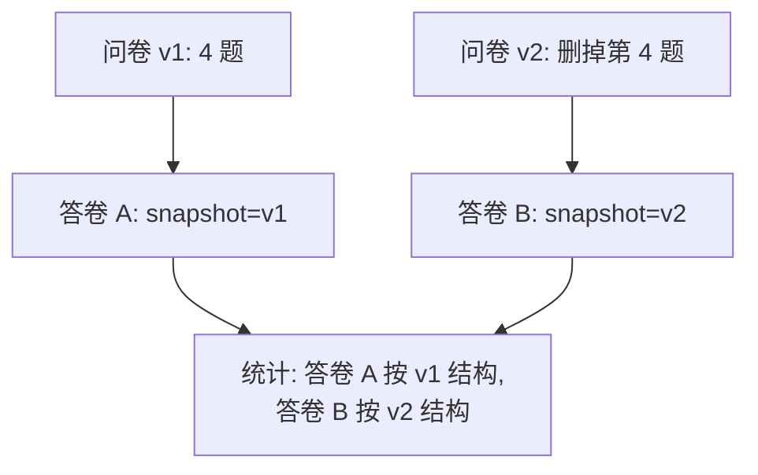

# 关键逻辑说明

## 1. 跳转引擎：问卷 = 有向图

**建模**：节点 = 题目，边 = 跳转规则（`when → goto`）+ 顺序边（下一题）。
规则声明式存储在题目文档里，引擎只解释算子，**绝不硬编码业务** ——
这是"跳转写死"要求（规则可配置）的实现方式。

**执行**（`jump_engine.simulate_flow`）：

1. 从第 1 题开始；
2. 依次求值当前题的 `jump_rules`，命中第一条即跳 `goto`；
3. 无命中 → 顺序下一题；到末尾 → 结束；
4. 执行时记录 visited 集合并**防环**（已访问过的题不再进入）。

**两个静态分析算法（保存问卷时运行）**：

| 算法 | 实现 | 效果 |
|------|------|------|
| 环检测 | DFS 三色标记（白=未访问，灰=在栈中，黑=已完成；访问到灰节点即成环） | 保存时**拒绝**循环规则并指出路径，如 `q1 → q3 → q1` |
| 死题检测 | 从第 1 题做可达性分析；当单选的全部选项都被 eq 规则覆盖时，顺序边判定失效 | 保存时**警告**"第 X 题在任何回答下都不可达" |

**条件算子**（`when.op`）：单选 `eq`；多选 `contains / count_gt / count_eq`；
数字 `gt / lt / eq / range`。前端 `jump.js` 有一份语义完全一致的 JS 镜像，
负责即时跳转体验；**提交时服务端重新执行引擎，服务器才是唯一可信边界**。

## 2. 校验引擎：声明式约束

约束全部来自题目文档字段（`options / min_select / text_min_len / num_min / integer_only…`），
校验器只是一张"题型 → 规则解释函数"的表。**新增题型 = 增加一条规则**，不触碰其他代码。

关键细节：**只校验实际到达的题目**。跳转会导致某些必答题被跳过 ——
引擎先算出 visited 集合，校验器只查 visited 内的题，避免被自己的跳转规则误伤。

错误统一格式 `[{question_id, message}]`，前端据此定位到具体题目显示红字。

## 3. 响应快照：旧数据与问卷修改解耦

提交答卷时，把**当时**的问卷题目结构（精简版）复制进答卷的 `snapshot` 字段。
之后问卷无论怎么修改（第二阶段必然发生），旧答卷依然能按提交时的结构统计。

这正是"旧数据必须保留、旧功能不能随意删除"要求的技术答案，也是
**为什么问卷要存快照而不做关系库外键/历史表**的论据。

## 4. 双通道统计：空间换时间 vs 实时计算

| | 快通道（写时预聚合） | 慢通道（读时聚合） |
|---|---|---|
| 时机 | 每次提交时 `$inc` 原子更新 stats | 手动重建时扫描答卷快照 |
| 复杂度 | 写 O(1)、读 O(1) | 写 0、读 O(答卷数) |
| 优点 | 统计页毫秒级、单文档原子自增 | 不依赖预聚合，可从答卷快照恢复 |
| 缺点 | 冗余存储，需处理重建 | 答卷多时慢 |
| 用途 | 统计首页/单题统计 | 迁移、`rebuild` 兜底与校验 |

**选择**：以快通道为主、慢通道为兜底，测试中二者结果互相校验
（`test_rebuild_matches_fast_channel`）。

**选项稳定性**：题目 ID 和选项文本分别经 SHA-256 摘要后作为 MongoDB 字段键，
原始选项标签单独保存。调整选项顺序或修改标签后，既有回答仍归属原选项，统计
视图会同时展示历史标签。重建时按每份答卷自己的 `snapshot` 汇总；旧版下标统计
会在首次读取或下一次提交前自动迁移。

**重建并发保护**：每次预聚合更新都会递增 `revision`。重建先记录版本，再以版本
条件替换统计文档；期间发生计数更新时会重新读取答卷并重试，避免覆盖已完成的
计数更新。

## 5. 并发与一致性

- **半份答卷**：答卷一次性 `insert_one`，单文档原子；
- **重复提交**：唯一索引 `{survey_id, respondent_key}` 原子拒绝（409）；
- **计数丢失**：stats `$inc` 原子自增，100 并发提交测试计数精确 = 100；
- **编辑覆盖**：surveys.version 乐观锁，冲突 409 提示刷新；
- **未授权访问**：owner 校验 403；非匿名问卷未登录连题目都看不到（401）。

## 6. 前端亮点逻辑

- **编辑器**：三栏布局（题目列表拖拽排序 / 编辑区 / 实时预览）；
  跳转规则可视化配置；debounce 自动保存携带 version；后端环检测/死题警告
  顶部弹窗展示；
- **填写端**：进度条 = 当前路径位置 / 总题数；"提交"按钮只有在当前题
  已合法作答且按跳转规则无下一题时才出现；
- **统计面板**：ECharts 环形图 / 柱状图 / 直方图；文本题词云
  （字号 ∝ 出现频次）+ 全量明细。
